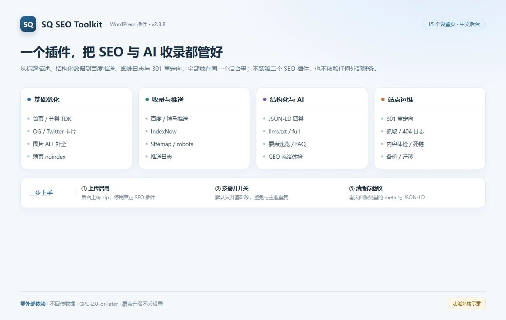
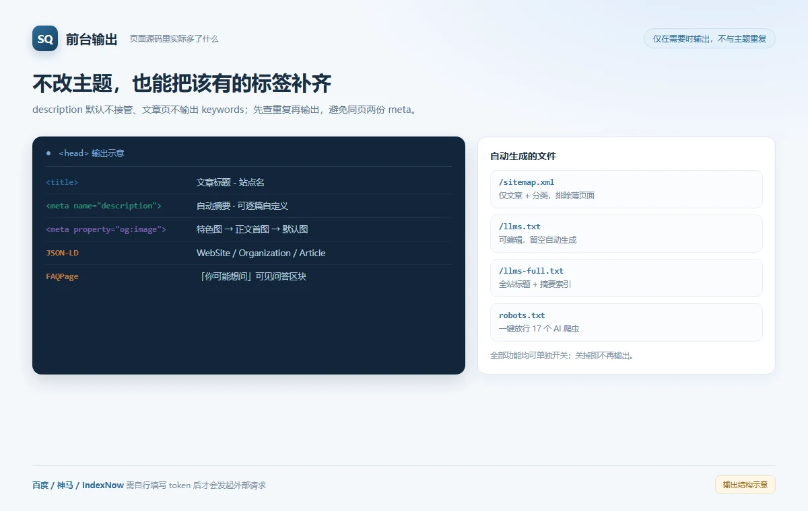
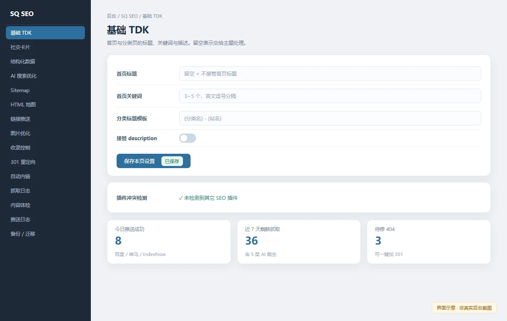

# 站优

轻量、全功能的 WordPress SEO 插件：中文后台、免授权、不回传任何数据。一个插件覆盖 TDK、Sitemap、AI 爬虫放行、llms.txt、OG / JSON-LD、百度与神马与 IndexNow 推送、蜘蛛日志、301 重定向、内容体检。

| | |
|---|---|
| 版本 | **2.3.8** |
| 环境要求 | WordPress 5.0+ / PHP 7.0+（测试至 WordPress 6.7） |
| 许可证 | GPL-2.0-or-later（见 [LICENSE](LICENSE)，插件包内附 `license.txt`） |
| 作者 | 狸猫 · <https://www.qinghuali.com/> |
| 源码 | <https://github.com/limaosou/sq-seo-toolkit> |

## 下载与安装

到 [Releases · v2.3.8](https://github.com/limaosou/sq-seo-toolkit/releases/tag/v2.3.8) 下载 **`sanqi-seo-2.3.8.zip` 附件**，然后：

1. WordPress 后台 → 插件 → 安装插件 → 上传插件 → 选择该 zip → 现在安装 → 启用；
2. 左侧菜单出现「SQ SEO」，逐页填写设置并保存；
3. 若站点有页面缓存插件或 CDN，清一次缓存，再在前台 Ctrl+F5 硬刷新验证。

也可以把本仓库的 `sanqi-seo/` 目录整包上传到 `wp-content/plugins/`。**目录名请保持 `sanqi-seo`**：旧版覆盖升级时，设置项 `sqseo_options` 与文本域 `sanqi-seo` 才能无缝保留。

> 请下载 Release 附件，不要用 GitHub 自动生成的 "Source code (zip)"：后者顶层目录是 `sq-seo-toolkit-2.3.8/`，装上后插件目录名会随版本变化；Release 附件的 zip 固定为 `sanqi-seo/`，兼容性最好。

## 功能

**基础输出**

- TDK 管理：首页标题 / 关键词、分类标题模板（支持 `{分类名}` `{站名}`）、文章自定义标题 / 关键词 / 描述
- OG / Twitter 社交卡片：微信、微博、Twitter 分享出图文卡片
- JSON-LD 结构化数据：WebSite + Organization + Article + BreadcrumbList
- 文章编辑框 SEO 字段、文章列表「SEO」状态列、薄页 noindex（标签 / 作者 / 搜索 / 日期）
- FAQ 问答区块：文章末尾可见问答 + FAQPage 结构化数据

**收录与爬虫**

- Sitemap：`/sitemap.xml`，仅含文章 + 分类，排除标签 / 作者等薄页面
- robots.txt：一键放行 17 个 AI 爬虫（GPTBot / ClaudeBot / PerplexityBot / Bytespider 等）
- llms.txt / llms-full.txt：后台可编辑，留空自动生成；全站标题 + 摘要索引供 AI 一次读完
- 百度主动推送、神马搜索推送、IndexNow（Bing / Yandex）：发布或更新文章时自动提交，带推送日志与手动补推
- 抓取日志：搜索引擎与 AI 爬虫记录 + 404 死链监控
- 站长平台验证码：百度 / 必应 / 神马 / 搜狗 / 360 一处填写自动输出 meta

**站点维护**

- 301 重定向：404 死链一键加跳转规则，支持完整 URL 粘贴与命中计数
- 内容体检：超期未更新文章清单 + 文章内链外链批量死链扫描
- 自动内链、`[sqseo_html_sitemap]` 访客版 HTML 地图、图片 ALT 自动补全
- 备份 / 迁移：全部设置与重定向规则一键导出 / 导入 JSON
- 插件冲突检测：检测到其他 SEO 插件运行时后台醒目提醒

## 运行效果

以下为运行效果示意图（非真实站点截图）：







## 外部服务与隐私

**默认安装后，本插件不会向任何第三方发起请求。** 以下三项只有在你主动填写站点与 token 之后才会启用：

| 服务 | 用途 | 触发时机 |
|---|---|---|
| 百度搜索资源平台「普通收录 → API 推送」`data.zz.baidu.com` | 把文章 URL 提交给百度 | 文章发布 / 更新 |
| 神马搜索「MIP 数据提交」`data.zhanzhang.sm.cn` | 同上，提交给神马（选填，适合移动端流量） | 文章发布 / 更新 |
| IndexNow `api.indexnow.org` | 把 URL 提交给 Bing / Yandex 等，留空即关闭 | 文章发布 / 更新 |

所有 token 只保存在你自己站点的数据库 `sqseo_options` 里，不会发送给作者或任何统计服务。

## 注意事项

- 启用前请停用其他 SEO 插件（Yoast / Rank Math / SEO合集等），**同屏只跑一个**，避免重复输出 meta 与结构化数据。
- 「接管 description」默认关闭：若主题已在输出 description，保持关闭即可。
- robots.txt 的 AI 放行仅在站点根目录没有物理 `robots.txt` 文件时生效（WordPress 动态生成模式）。
- 本仓库为对外发布版（作者「狸猫」、v2.3.8、目录 `sanqi-seo/`）；另有 WordPress.org 提审版使用 slug `sq-seo-toolkit`、版本 1.0.0。两套包设置键相同，**切勿同时启用**。

## 卸载与升级

- **卸载**：后台「插件 → 已安装插件 → 删除」会执行 `uninstall.php`，清除 6 个 option、8 个 post meta 与每日日志清理定时任务。删除前请先到「SQ SEO → 备份 / 迁移」导出 JSON 留底。
- **覆盖升级**：从旧版 `sanqi-seo` 直接覆盖文件即可，设置项、文件夹名与文本域均保持兼容，不会丢配置。

完整功能列表与更新日志见 [`sanqi-seo/readme.txt`](sanqi-seo/readme.txt)。

## 目录结构

```text
sq-seo-toolkit/
├── LICENSE                  GPL-2.0 全文
├── README.md                本文件
├── screenshots/             运行效果示意图
└── sanqi-seo/               ← WordPress 插件本体（上传/打包用这个目录）
    ├── sanqi-seo.php
    ├── readme.txt           WordPress.org 格式说明与 Changelog
    ├── uninstall.php        卸载清理
    ├── admin.css
    ├── admin.js
    └── license.txt
```
